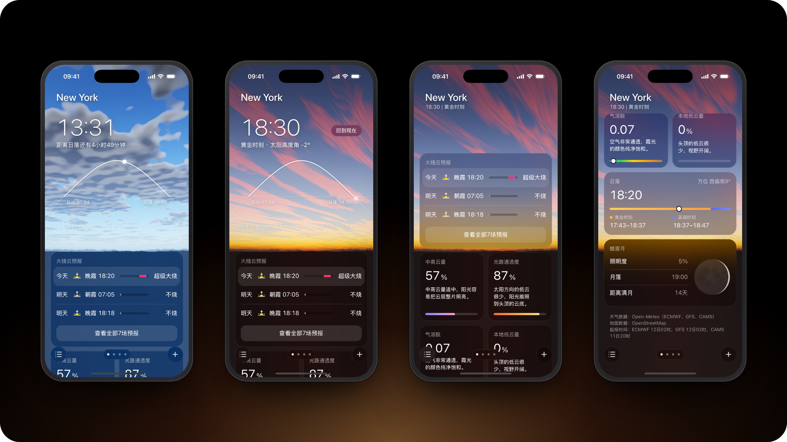

<p align="center">
  
</p>

# Dawn 黎明守护者

**Sunrise and sunset glow forecast for the next four days.**

Dawn 黎明守护者 is a mobile web app that tells you whether the next sunrise or sunset will light up the clouds. It reads the ECMWF and GFS cloud forecasts at eight points toward the sun, out to 400 km, adds the CAMS aerosol forecast, and rates each event from 不烧 (none) to 超级大烧 (epic). Behind every page is the sky it forecasts, rendered in WebGL from the same data, with the clouds drifting on the forecast winds. Drag the sun along its path and the sky follows it through the day. The interface is in Chinese. On an iPhone it runs full screen once added to the Home Screen.


<p align="center">
  
</p>
<p align="center"><sub>New York at midday and in tonight's sunset glow, then the cards further down: the glow forecast, what makes it, golden and blue hour, and the moon. All live forecasts, captured in the iOS Simulator.</sub></p>

## How the forecast works

Each place gets eight points along the azimuth of its sunrise and sunset, at 0, 25, 50, 100, 150, 200, 300 and 400 km. For every event, the low, mid and high cloud cover of ECMWF IFS and NCEP GFS at those points goes into five factors, scored for each model separately:

- mid and high cloud near you, which the low sun lights from below
- low cloud along the path, and the far end of a mid deck, which block that light on its way in
- local low cloud that hides the sky
- aerosol optical depth from CAMS
- rain at the place

The two scores are averaged, and the bar beside each event spans both, so its length shows how far the models agree. Sunrise and sunset, golden and blue hour, moonrise, moonset and the phase of the moon come from astronomy-engine.

## The sky

The sky shows the present, or any moment from two hours before sunrise to two hours after sunset that you drag the sun to. Tapping a sunrise or sunset in the forecast jumps to three minutes after sunset, or before sunrise, when the glow is at its best. The atmosphere is single scattering through Rayleigh, Mie and ozone layers over a round Earth, traced on a coarse grid whenever the moment changes. Three cloud layers are drawn every frame from a tiling noise texture: cloudlets gathered into masses for low and mid cloud, and bands of fine strands for cirrus. They are cut to the forecast cover at each distance, lit from their sunward side, and carried by the 850, 600 and 300 hPa winds. The view faces the low sun at sunrise and sunset and turns its back on it once it has climbed; after dusk the stars come out. With reduced motion turned on, the clouds stay still.

## Development

```bash
pnpm install
pnpm dev
```

```bash
pnpm typecheck && pnpm lint && pnpm test --run && pnpm build
```

## Data

Weather data by [Open-Meteo](https://open-meteo.com) (ECMWF IFS, NCEP GFS and CAMS), licensed under CC BY 4.0. Place search by [Photon](https://photon.komoot.io) and Open-Meteo geocoding, and the name of your location by [Nominatim](https://nominatim.org) under the [OSMF usage policy](https://operations.osmfoundation.org/policies/nominatim/); map data © [OpenStreetMap](https://www.openstreetmap.org/copyright) contributors.
