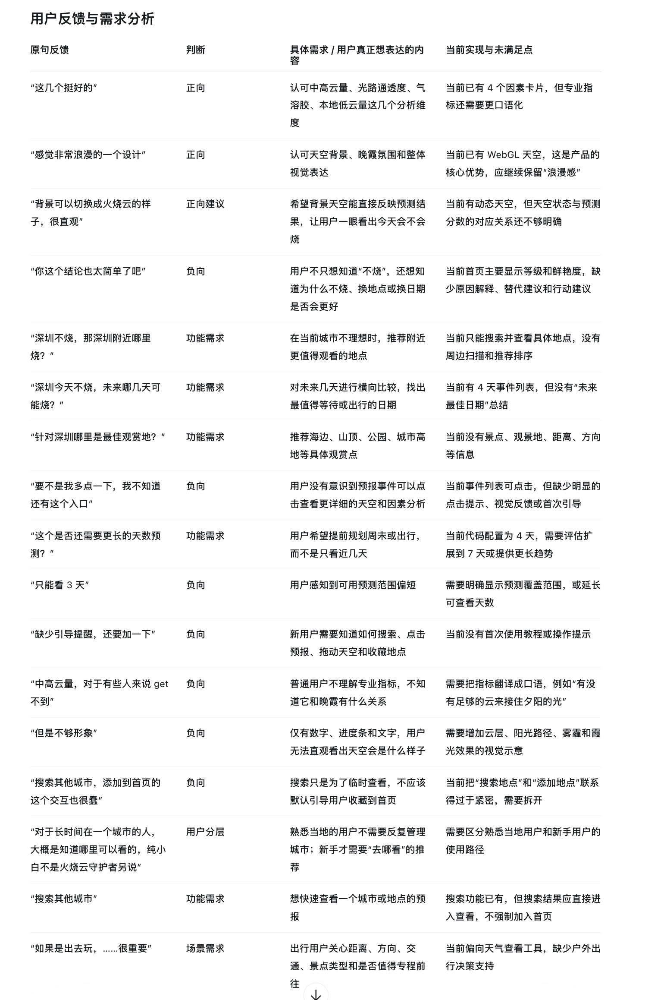
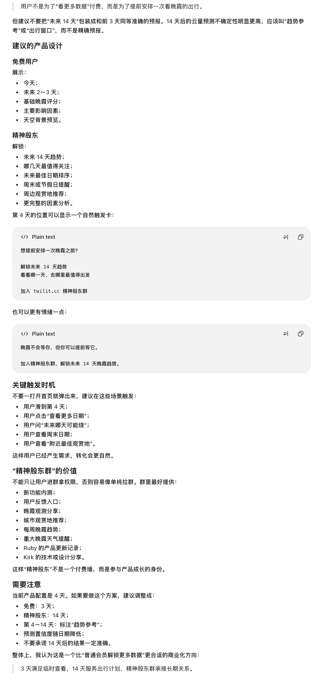
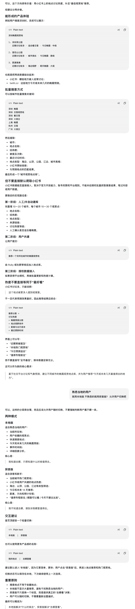

# 用户反馈与产品需求整理

这份整理把三张用户提供的截图转成可追踪的产品建议，并附上第一批城市观赏点候选库。原始截图保存在 [`source-images/`](source-images/)，截图中的陈述代表反馈和建议；实现现状以仓库代码核对为准。

网页版本：[中英双语产品建议](index.html)。

## 核心判断

Twilit 已有四天朝晚霞预报、因素解释、可交互的 WebGL 天空、地点搜索和收藏。反馈主要指向三个体验问题：用户看不出哪一场值得等、看不懂云量等指标与晚霞的关系、出游用户缺少观赏点和行程判断依据。建议保留浪漫的天空体验，把预报结论、场次切换、观赏地点和使用路径做得更清楚。

## 反馈、实现现状与建议

| 用户反馈 | 当前实现核对 | 建议 |
| --- | --- | --- |
| 四个因素卡片不错；整体设计浪漫 | 四因素卡和 WebGL 天空已存在 | 保留视觉风格；因素标题优先使用口语，专业名词作为补充信息 |
| 背景能否直观展示“火烧云” | 可点选预报场次预览天空；默认天空时间与所选场次解释需要更明确 | 显示实时/预览状态、对应日期与朝晚霞；用太阳、远处云层和观察者的示意解释光路 |
| 结论太简单，想知道为什么、换地点或日期是否更好 | 有因素解释，综合判断、主导原因和行动建议不足 | 提供“预测等级—主要原因—可做什么”；比较未来场次时说明并列、数据缺失和模型分歧 |
| 不知道预报能点；缺少新手提示 | 预报行是可点击按钮，但提示不明显；没有完整的可视引导 | 在首次搜索、点选预报、拖动太阳时给轻提示，允许关闭和重看 |
| 中高云量等指标不易懂；数字和文字不够形象 | 已有专业指标及部分解释 | 改写为“有多少云能被照亮”“夕阳能否照到云底”“空气通透程度”“低云会挡住多少天空”，配合机制图 |
| 只能看三天、想提前规划更长时间 | 当前配置为四天；列表默认只露出部分场次，容易被理解成三天 | 明示实际日期范围，按天展示朝霞/晚霞；远期单独标成趋势参考并显示可信度变化 |
| 深圳不烧时，附近哪里烧；未来哪天更值得出行 | 已有逐地点预报，未有附近扫描、场次横向比较和最佳日期总结 | 先做轻量场次摘要与小范围城市比较，显示距离、预测差异和数据完整度，不强行推荐低分结果 |
| 想找深圳海边、山顶、公园等具体观赏地 | 可搜索地点，但没有经过整理的观赏点库、机位朝向和开放信息 | 先人工整理 10–20 个城市，每城 10–30 个候选点，逐步核验位置、适合朝/晚霞的条件与来源 |
| 搜索城市和添加首页地点容易混淆 | 搜索进入详情、收藏由单独按钮完成，但部分文案仍写“搜索以添加” | 搜索明确为“搜索地点/查看预报”；收藏明确为“收藏地点”，保持两种动作的含义清楚 |
| 熟悉本地的用户和出游新手需要不同体验 | 已有定位、收藏和地点搜索 | 提供“本地版/探索版”轻量切换；默认本地快速查看，探索版强调观赏点、距离、方向和出行条件 |
| 出去玩还要看距离、方向、交通和景点类型 | 已有太阳方位和地点坐标基础；路线时间、交通及观赏点元数据不足 | 先展示可确认的直线距离、方向、类别和准入信息；路线时长与交通信息接入可靠来源后再展示 |

## 预测窗口与会员建议

用户付费动机更接近“提前安排一次值得等待的日出或日落”，而不是解锁更多数字。可将产品层次设计为：

| 体验 | 建议内容 |
| --- | --- |
| 免费 | 今天及未来 2–3 天、基础朝晚霞等级、主要影响因素、天空背景预览 |
| 精神股东/支持者 | 最多 14 天的趋势参考、值得关注日期、周末提示、周边观赏点、扩展因素分析和每周趋势 |

14 天远期应称“趋势参考”或“出行窗口”，不应与前三天并列为同等准确的预报。随日期变远显示可信度下降，不承诺固定命中率。当前用户到达第 4 天、点击查看更多日期、查询周末或打开附近观赏地时，可自然展示延长范围的价值；不在打开首页时弹窗。

支持者社群应有真实参与价值，例如新功能内测、反馈入口、观测分享、城市地点推荐、每周趋势和重大天气提醒，以及产品更新记录。不能把群入口当作单一付费墙。

## 城市观赏点库：首批数据

已整理 **15 个城市、每城 15 个，共 225 个候选点**，覆盖深圳、广州、珠海、厦门、福州、杭州、上海、南京、苏州、武汉、成都、重庆、青岛、大连和三亚。

| 文件 | 用途 |
| --- | --- |
| [`catalog.json`](../../../data/viewpoints/catalog.json) | 应用或数据处理使用的完整结构化数据 |
| [`catalog.csv`](../../../data/viewpoints/catalog.csv) | 表格审阅和批量维护 |
| [`validation.json`](../../../data/viewpoints/validation.json) | 数量、证据等级和待核验项 |
| [`README.md`](../../../data/viewpoints/README.md) | 字段、来源、坐标与更新规则 |

当前 208 个有地标参考坐标，17 个坐标未确认；证据等级 A/B/C 分别为 58/117/50。A 表示官方或地方新闻材料直接提及地点与朝晚霞/日出日落，B 为旅游平台或二手资料，C 为地点资料可追溯但观赏用途主要来自地形判断。等级不是观赏效果、天气质量或实地机位的认证。

数据明确将地标坐标与拍摄机位分开：`camera_position` 当前为空，所有点 `field_verified` 为 false。票价、开放时间、步行时间、社交热度和天气评分等动态或未核验信息为空。没有直接抓取小红书内容，也没有把讨论热度当成天气或观赏质量。来源链接和 OpenStreetMap 署名要求见数据说明。

## 分阶段落地

1. **体验清晰度**：按天组织预报；显示覆盖日期、可点击提示、所选场次上下文；加入综合结论和未来值得关注的场次；改好口语指标、搜索/收藏文案与轻量引导。
2. **预测窗口**：验证各天气模型、风场和气溶胶的数据时效与缺测处理后，再提供 7 天或 14 天趋势。远期数据单独标识，明确不确定性；不以接口可响应代替预测完整性。
3. **观赏点试点**：先从现有 15 城候选库人工审校开始，补充具体机位、方向、地平线遮挡、开放状态与核验日期。搜索临时地点直接查看预报，只有用户明确收藏时才加入首页。
4. **用户共建和比较**：支持用户提交地点，由维护者审核来源和坐标后入库；再做同一日期的周边天气比较。天气评分、观赏条件、距离和可达性分项展示，避免混为一个“最好看”结论。

用户提交字段建议包括城市、地点名、坐标或地图链接、地点类别、适合朝霞/晚霞、视野说明和来源。审核时核对同名异地、行政区、坐标系、可进入性和来源许可。社交平台内容仅在授权且符合平台规则时接入；未经授权不批量爬取。

## 验收重点

- 用户能看出预报覆盖哪些日期、朝霞和晚霞分别对应哪一场；点击后天空、因素和解释使用同一场次上下文。
- 比较结果覆盖低分、相近场次、模型分歧、缺测和已经过去的场次，不为了排序硬推行程。
- 每个观赏点保留来源、坐标来源、证据等级和核验状态；地标坐标不会显示成相机机位。
- 搜索与收藏可以分别完成；用户可临时搜索并查看其他城市，不必将它加入首页。
- 新手提示不遮挡天空，支持关闭和重新查看；熟悉用户可直接使用本地路径。
- 远期趋势有明确标签和随日期降低的可信度提示，不宣称 14 天结果与近期预报同样准确。

## 原始截图

以下图片是用户提供的反馈材料。截图文字作为需求输入，是否已实现需查看代码或后续产品验收。

